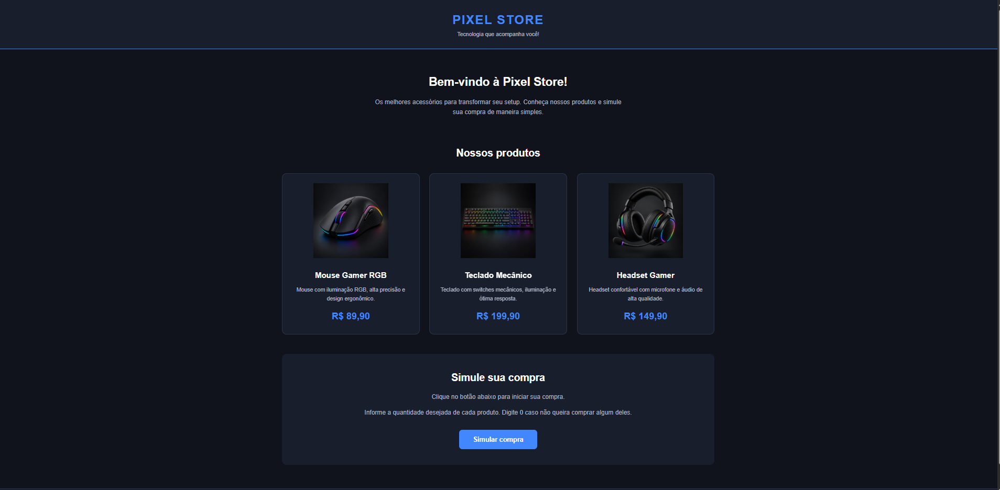

# Pixel Store - Simulador de Compras

## Sobre o projeto

A Pixel Store é uma loja fictícia de acessórios de tecnologia,
desenvolvida como parte do Desafio 1 do Programa Trilhas 3B,
na trilha de Desenvolvimento Mobile.

O objetivo é praticar HTML, CSS e JavaScript por meio de uma
página que permite simular compras de produtos.

## Aluno

- Nome: Denilson Alves
- Programa: Trilhas 3B
- Trilha: Desenvolvimento Mobile

## Produtos

| Produto | Preço |
|---------|-------|
| Mouse Gamer RGB | R$ 89,90 |
| Teclado Mecânico | R$ 199,90 |
| Headset Gamer | R$ 149,90 |

## Tecnologias utilizadas

- HTML5: estrutura da página.
- CSS3: estilização e responsividade.
- JavaScript: lógica da simulação de compras.

## Como executar

1. Baixe ou clone este repositório.
2. Abra a pasta do projeto.
3. Abra o arquivo `index.html` em um navegador.
4. Clique no botão "Simular compra".
5. Informe as quantidades desejadas.
6. Confira o resumo da compra.

## Funcionalidades

- Apresentação de três produtos.
- Solicitação de quantidades com prompt().
- Conversão de dados utilizando Number().
- Validação de quantidades.
- Cálculo dos subtotais e do total da compra.
- Exibição do resultado com alert().
- Layout responsivo.

## Captura de tela

## Estrutura do projeto

pixel-store/
├── index.html
├── style.css
├── script.js
├── README.md
└── assets/
    ├── mouse.png
    ├── teclado.png
    ├── headset.png
    └── screenshot.png
